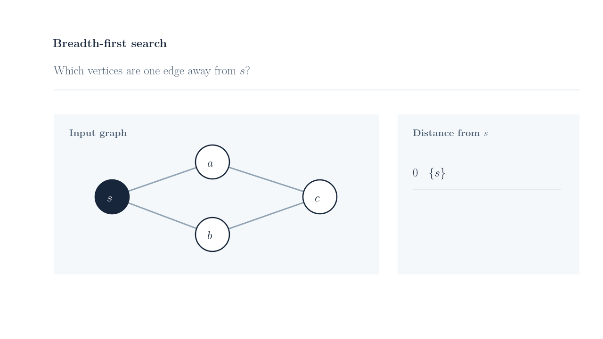
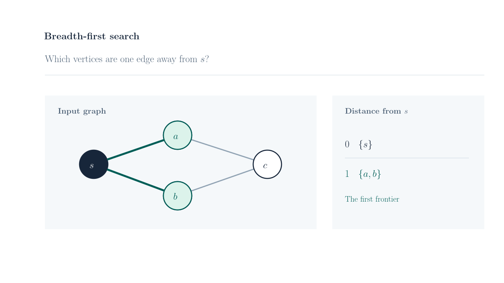

# Ipe MCP

[](https://www.npmjs.com/package/ipe-mcp) [](./LICENSE) [](https://nodejs.org/) [](./docs/guides/package-installation.md#supported-native-prerequisites)

Ipe MCP lets an AI assistant create and edit drawings and presentations in Ipe. Ask for a diagram, a slide with LaTeX labels, or a proof that unfolds one step per click. You get an editable `.ipe` file you can open in Ipe and a PDF or PNG when you need to present or share it.

## Why use it?

- **Keep the drawing editable.** Revise individual shapes, labels, layers, and views in Ipe or ask your assistant to change them in a later turn.
- **Present one step at a time.** Use successive Ipe views to reveal a proof or show the next move on a board. Each exported view becomes a PDF page.
- **Review changes before saving.** The assistant works in a separate session. You can preview the result, ask for revisions, and explicitly save it.

The Ipe editor window can stay closed while the server works on saved files.

## One slide, two views

<p>
  
  
</p>

[Open the editable Ipe example](./docs/examples/breadth-first-search/breadth-first-search.ipe).
The second view reveals the first BFS frontier on the same graph.
Each view becomes a page when exported to PDF.

## Install

| Install from | Available features |
| --- | --- |
| [npm](#from-npm) or [GitHub Releases](#from-github-releases) | Stable package with stdio, editable Ipe documents, discrete views, SVG/PDF import, native preview and export, authenticated local HTTP, and the opt-in WSL bridge. |
| [Source](#from-source) | Build the current source with the same package entry points. |

### From npm

```bash
npm install -g ipe-mcp@1.0.0
```

The global install adds the `ipe-mcp` executable to npm's global bin directory.
Make sure that directory is on your client's `PATH`.

### From GitHub Releases

Install the stable package directly from the release asset. [Release downloads](https://github.com/Mik1810/ipe-mcp/releases/tag/v1.0.0)

```bash
npm install -g \
  https://github.com/Mik1810/ipe-mcp/releases/download/v1.0.0/ipe-mcp-1.0.0.tgz
```

### From source

```bash
git clone https://github.com/Mik1810/ipe-mcp.git
cd ipe-mcp
npm ci
npm run build
ipe_package_dir="$(mktemp -d)"
npm pack --ignore-scripts --pack-destination "$ipe_package_dir"
npm install -g "$ipe_package_dir/ipe-mcp-1.0.0.tgz"
```

### Add the tools you need

Basic `.ipe` editing and structural checks use Node.js. For LaTeX rendering,
native validation, and PDF or PNG export, install the native tools separately.
The verified baseline uses Ipe 7.2.30 on Ubuntu 26.04 WSL2. [WSL setup guide](./docs/guides/package-installation.md#supported-native-prerequisites)

```bash
sudo apt update
sudo apt install ipe \
                 lua5.4 \
                 texlive-latex-base \
                 texlive-latex-recommended \
                 poppler-utils \
                 mupdf-tools \
                 bubblewrap \
                 util-linux
```

For **PDF import**, install `mupdf-tools`, `bubblewrap`, and `util-linux`. Supported SVG import runs in Node.js. For **local HTTP**, install `util-linux` for `flock`. The npm package keeps these system tools external.

## Connect your assistant

Create a dedicated directory for the drawings the server may access.

```bash
mkdir -p "$HOME/ipe-work"
```

### Codex over stdio

Add this to your Codex configuration in `~/.codex/config.toml`. Replace `/home/your-user/ipe-work` with the absolute path to your directory.

```toml
[mcp_servers.ipe-mcp]
command = "ipe-mcp"

[mcp_servers.ipe-mcp.env]
IPE_MCP_WORKSPACE_ROOT = "/home/your-user/ipe-work"
```

You can also install the local Codex plugin, which adds the Ipe authoring skill
and registers the server. [Install the local Codex plugin](https://github.com/Mik1810/ipe-mcp/blob/v1.0.0/docs/guides/codex-plugin.md#install-locally)

### Claude Code

Run this from the project where you use Claude Code. For instance, if you are working on a project in a WSL environment, run both Claude Code and the server inside WSL.

```bash
claude mcp add --transport stdio --scope local ipe-mcp \
  --env "IPE_MCP_WORKSPACE_ROOT=$HOME/ipe-work" -- ipe-mcp
```

`--scope local` stores the server in `~/.claude.json` for this project. Use `--scope user` to enable it across your projects, or `--scope project` to write a shared `.mcp.json` at the project root. Run `/mcp` in Claude Code to check the connection.
[Claude Code MCP configuration](https://code.claude.com/docs/en/mcp)

### GitHub Copilot in VS Code or another MCP client

On WSL, open the workspace in a VS Code WSL window. Add this configuration to `.vscode/mcp.json`. For another client that supports stdio, use `ipe-mcp` as the executable and set the same workspace environment variable in its configuration.

```json
{
  "servers": {
    "ipe-mcp": {
      "type": "stdio",
      "command": "ipe-mcp",
      "env": {
        "IPE_MCP_WORKSPACE_ROOT": "/home/your-user/ipe-work"
      }
    }
  }
}
```

### Run with npx

You can skip the global npm install by using `npx` as the server command with arguments `["--yes", "ipe-mcp@1.0.0"]`. Keep the same workspace environment variable. For Claude Code, use `-- npx --yes ipe-mcp@1.0.0` at the end of the `claude mcp add` command.

### Authenticated local HTTP

Start `ipe-mcp-http` with a private bearer-token file. Point your client on the same host to `http://127.0.0.1:8765/mcp`.
[Set up the token and connect over HTTP](https://github.com/Mik1810/ipe-mcp/blob/v1.0.0/docs/guides/local-http.md)

The package also includes an opt-in bridge for an open Ipe window on WSL.
[Set up the live Ipe bridge](https://github.com/Mik1810/ipe-mcp/blob/v1.0.0/docs/guides/live-ipe-bridge.md)

## Try your first slide

> Use Ipe MCP to create a 16:9 slide showing the first step of breadth-first search. Start by calling `ipe_orientation` and `ipe_get_capabilities`. Tell me if the Ipe MCP tools are unavailable. In the first view, show a four-vertex graph and mark the start vertex. In the second view, highlight the vertices one edge away and list them next to the graph. Keep the graph in place. Use Ipe MCP to preview both views, then ask me to confirm before saving the editable Ipe file and exporting the PDF.

[Documentation map](./docs/README.md) - [Support policy](https://github.com/Mik1810/ipe-mcp/blob/v1.0.0/docs/guides/support-policy.md) - [MIT license](./LICENSE)
